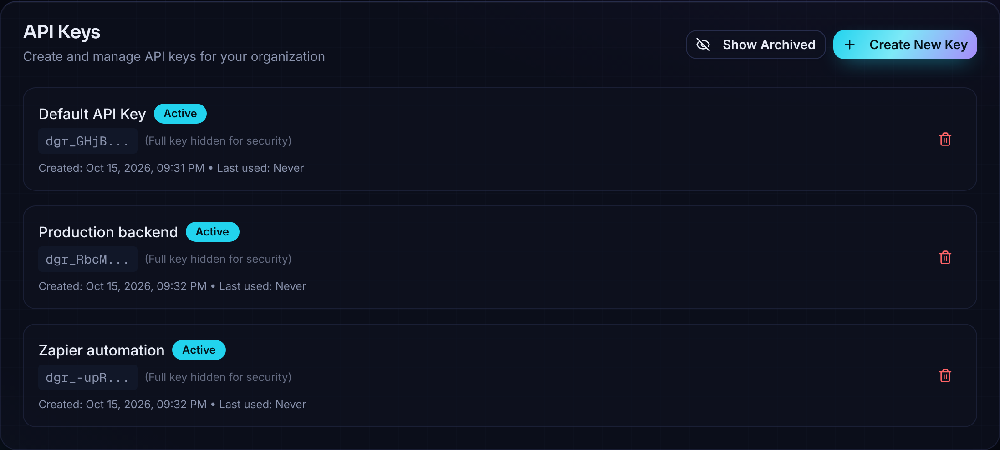
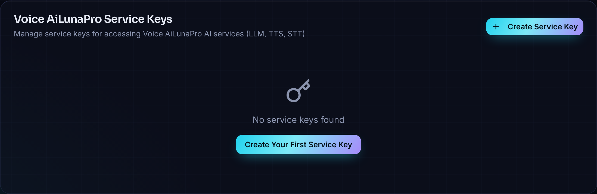

The option to create the Keys is in https://voice.ailunapro.com/api-keys.

### API Keys
API keys can be used to trigger a voice agent from an external system, like n8n or programatically from your other workflows. In order to generate that, you can go to `/api-keys` and create a new key. 

Please note that you must copy and keep the API key secretly, since this is the only time that you would be able to copy it. If you lose it, you can always delete that, if its not being used anywhere, and create a new API key. 

### Service Keys
Service Keys are the keys which you generate to be used in [Model Configurations](/configurations/inference-providers). In order to generate that, you can go to `/api-keys` and create a new key. 

<Warning>
Service Keys are scoped to the AiLunaPro account that created them. You cannot use a Service Key from one AiLunaPro account in another account; create a new Service Key from the account where you want to use it.
</Warning>
