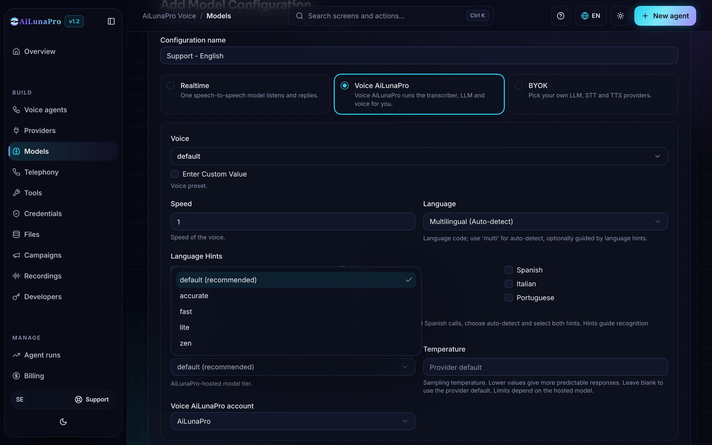
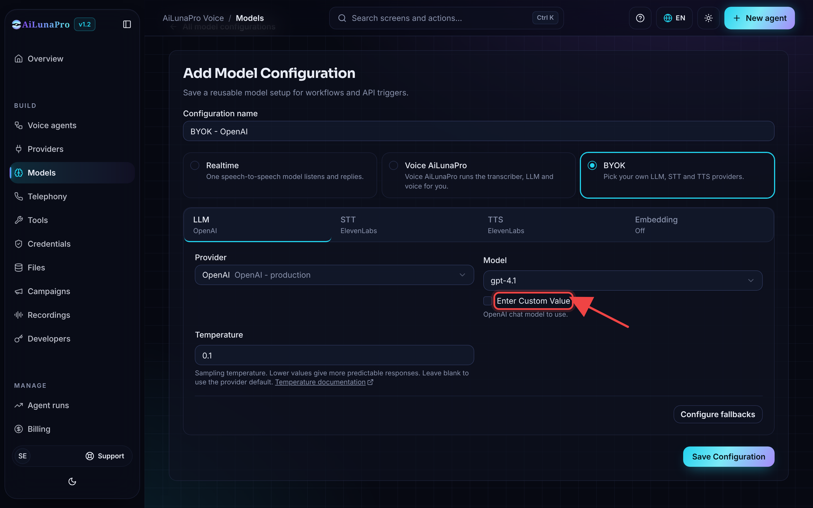

Voice AiLunaPro supports OpenAI, Google AI Studio, Google Vertex AI, Azure OpenAI, AWS Bedrock, Groq, Hopper, OpenRouter, Hugging Face, MiniMax, Sarvam, and AiLunaPro-managed LLMs. There are some models provided by default for you to choose from the drop down. 

<Warning>
LLM providers receive the data needed to generate responses, such as prompts, conversation history, model settings, and any configured tool/function definitions or tool call context. Review the provider's data processing, retention, model training, and regional hosting policies before using sensitive data.
</Warning>

For locally deployed or self-hosted LLMs, AiLunaPro also supports OpenAI-compatible endpoints such as Ollama and vLLM.

If you don't find a model in the drop-down, tick **Enter Custom Value** and type the model name.

## OpenRouter provider routing

By default OpenRouter spreads requests across every provider that serves a model, weighted toward the cheapest. For voice agents that can add noticeable latency, because each turn may land on a slower provider.

Use **Provider order** to list the OpenRouter provider slugs to try first, in order, one slug per entry (for example, `groq`). The slugs are shown on each model's page on OpenRouter. If none of the listed providers is available, OpenRouter falls back to its other providers, so calls keep working.
